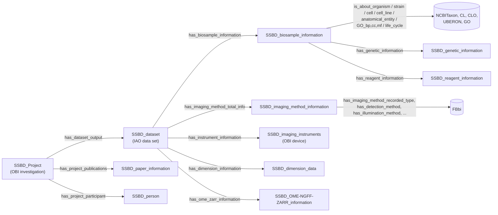

# SSBD Ontology: research and LAMBDA alignment

The SSBD Ontology is RIKEN's OWL model for the metadata of the [Systems Science of Biological Dynamics database](https://ssbd.riken.jp) (SSBD). SSBD shares light-microscopy and volume-EM images of cells, tissues and whole organisms, and quantitative data derived from them. The ontology matters to LAMBDA for two reasons. It is a working example of describing bioimages with OBO vocabularies (FBbi for imaging methods; NCBITaxon, CL, UBERON and GO for the specimen). Its two-tier split also resembles the one between LAMBDA's RO-Crate core profile and the full LinkML Dataset.

Research date: 2026-11-09. Scope:

- SSBD's curation template (metadata model v3.1), field by field
- the ISWC 2025 paper that describes the ontology
- the ontology files and example instances in `openssbd/ssbd-ontology`
- the live SSBD SPARQL endpoint

All four were compared with this repository's schema. This is a design assessment, not an implemented crosswalk or ingest. No schema changes were made.

## Findings

- **The spreadsheet template is the schema; the OWL is what it is converted into.** Curators fill in a spreadsheet, and an ontologist converts the sheets to RDF. The template's field list, cardinalities and typed ranges (float plus a UO unit, FBbi, NCBITaxon, CLO, ChEBI) are therefore the right thing to map LAMBDA against. The RDF loses some of that typing.
- **The conversion has two faults that affect anyone loading SSBD.** The template keeps each physical scale as a float with a separate UO unit, but the RDF stores one string such as `"1.1 micrometer"`. The template documents the dimension string as X×Y×Z×T×C, but every instance that can tell the two orders apart is written X×Y×Z×C×T. The template's own example dataset is among them. See [Quality notes](#quality-notes-for-anyone-ingesting-ssbd).
- **Aligning matters more than importing.** SSBD and LAMBDA overlap only at the edges. SSBD has no macromolecule, structure, crystallography, scattering or single-particle content. LAMBDA has little for light microscopy. Where they meet (specimen biology, imaging method, image geometry, OME-Zarr storage), SSBD uses OBO terms that LAMBDA already uses or could adopt cheaply. If both sides use the same IRIs, records join without a crosswalk.
- **LAMBDA can't yet hold an SSBD light-microscopy dataset faithfully.**
  - `ExperimentRun.technique` is required, but `TechniqueEnum` has no light-microscopy value at all.
  - `Image.pixel_size` and `Image3D.voxel_size` are single values, so the anisotropic voxels typical of confocal stacks and FIB-SEM (e.g., 0.105 × 0.105 × 0.5 µm) don't fit.
  - There is no time-lapse interval.

  These are the main gaps; the full list is in [Gaps this exposes in LAMBDA](#gaps-this-exposes-in-lambda).
- **FBbi is the main missing vocabulary.** LAMBDA describes techniques with CHMO and PaNET and has no FBbi terms. SSBD, the BioImage Archive and IDR use FBbi for imaging methods. FBbi also has distinct terms LAMBDA lacks today: cryo-electron tomography (`FBbi:00100015`), which `TechniqueEnum.cryo_et` currently shares with `cryo_em` (`CHMO:0002413`), and FIB-SEM (`FBbi:00050000`).
- **SSBD is still settling, so don't import it.** It has domain-less properties, near-duplicate property pairs and test classes in the release. The class names in the paper differ from those in the release, and the paper describes SHACL shapes that aren't published. Depending on SSBD IRIs would tie LAMBDA to a model that is still changing; depending on the OBO terms underneath does not.

## Authoritative sources and versions

| Source | Purpose |
| --- | --- |
| [SSBD metadata model v3.1](https://github.com/openssbd/ssbd-metadata/blob/4bc869dc0bbffe1be92c91b0fe8ee9ab4b2335ba/latest/model/ssbd-metadata-model_v3.1.xlsx) (`openssbd/ssbd-metadata` @ `4bc869d`, file dated 2024-09-02) | The curation template: 112 fields in 10 record types, with necessity, multiplicity, range and examples. The repo README still calls v2 the current release and `latest` (v3.1) under development; the paper treats v3 as current |
| [Yamagata et al., *SSBD Ontology: A Two-Tier Approach for Interoperable Bioimaging Metadata*](https://doi.org/10.1007/978-3-032-09530-5_19), ISWC 2025, LNCS 16141, pp. 1–11 ([arXiv:2508.02084](https://arxiv.org/abs/2508.02084)) | Design rationale, curation workflow, counts, competency queries |
| [openssbd/ssbd-ontology @ `0957cae`](https://github.com/openssbd/ssbd-ontology/tree/0957cae1fd3b6d65f03f7137625d3eab33274bc7) | OWL/Turtle ontology (`ontology/ssbd_v20250512.ttl`, `ssbd_core.owl`, `ssbd_integrated.owl`), example instances (`instance/`), SPARQL examples (`sparql/`). Last commit 2025-08-07 |
| [Zenodo 10.5281/zenodo.15700645](https://doi.org/10.5281/zenodo.15700645) | Archived ontology release v20250512, CC-BY 4.0 |
| [BioPortal: SSBD](https://bioportal.bioontology.org/ontologies/SSBD) | Registry entry. Namespace `http://ssbd.riken.jp/ontology/` |
| [SPARQL endpoint](https://knowledge.brc.riken.jp/bioresource/sparql) | Live graph `http://metadb.riken.jp/ontology/SSBD` |
| [Kyoda et al., NAR 53:D1716 (2025)](https://doi.org/10.1093/nar/gkae860) | The SSBD platform itself |
| [foundingGIDE D6.1, 10.5281/zenodo.15553217](https://doi.org/10.5281/zenodo.15553217) | Ontology usage across SSBD, IDR and BIA; REMBI → SSBD field mapping (not reviewed here) |

The figures below come from three places: parsing the template with `openpyxl`, parsing the Turtle files with `rdflib`, and queries to the live endpoint on the research date.

## Model

### Two tiers and the curation workflow

SSBD splits its metadata into two tiers:

- **SSBD:repository** takes deposits quickly. It needs only four classes: project, dataset, paper information and person. The paper says SHACL shapes check its cardinalities (exactly one paper and at least one dataset per project), while OWL declares the same constraints for reasoners. Paper records are enriched automatically with MeSH Topical Descriptors from PubMed.
- **SSBD:database** is the curated, added-value tier. It adds the specimen biology, imaging method, instrument, image dimensions and OME-Zarr access to the same dataset records.

The work is split between curators and an ontologist. Domain curators fill in the spreadsheet template and imaging experts review it. An ontologist then converts the sheets to OWL/RDF instances against the core classes. HermiT checks the result for consistency, and it is loaded into an Apache Jena Fuseki store. That store also holds MONDO, so one query can go from an SSBD biosample's GO term to related diseases. SSBD's older RDF, at metadb.riken.jp, was flat instance data that hasn't been updated since 2018. That is where the current graph name comes from.

For data access the paper describes two steps. SPARQL finds the dataset URIs, then SSBD's REST/NGFF APIs stream the OME-Zarr images and BDZarr quantitative tables.

LAMBDA has a similar split. The RO-Crate core profile is the small set a facility can always produce. The full LinkML `Dataset` holds the curated relational detail.

### The curation template (metadata model v3.1)

| Record | Fields | Required fields | Notable typed ranges |
| --- | --- | --- | --- |
| Project | 17 | SID, name, URL, DOI, title, description, date of submission, license, version; person 1..n, paper 1, dataset 1..n | CC license |
| Person | 13 | role 1..n, first name, last name, e-mail, organization | ORCID, J-GLOBAL, researchmap |
| Paper | 5 | none (DOI and URL recommended) | PubMed ID, PMC ID |
| Dataset | 9 | ID, title, dimensions, biosample 1..n | |
| Dimensions | 10 | dimensions string | X/Y/Z scale and T interval, each a float plus a UO unit; channel count as int |
| Biosample | 11 + 9 related | description, organism | NCBITaxon, CL, CLO, UBERON, GO BP/CC/MF, MeSH; strain as text plus URL |
| Imaging Method | 10 | none | nine FBbi facets, plus MeSH |
| Instruments | 7 | none | all free text: body, module, light source, detector, objective, filter set, dichroic |
| Genetic | 12 | none | Ensembl, UniProtKB, EFO method URI, FBbi tag URI (e.g., `FBbi:00000477` VenusFP) |
| Treat | 9 | none | ChEBI compound, with concentration and fold dilution each as value + unit + UO URI |

Only Project, Person, Dataset, Dimensions and Biosample have required fields. Everything that makes a record "added-value" is recommended or optional, which matches the two-tier design.

### Core classes in the OWL

The paper gives these counts as of 2025-05-12: 1,478 classes, 522 instances and 235 properties (116 object, 119 data). Only 34 of the classes are in the SSBD namespace. The rest are copied from other ontologies:

| Source | Classes | Source | Classes |
| --- | --- | --- | --- |
| FBbi | 527 | CL | 69 |
| GO | 343 | IAO | 62 |
| NCBI Gene (non-OBO IRIs) | 131 | CLO | 56 |
| UBERON | 84 | UO | 39 |
| NCBITaxon | 75 | OBI, CHEBI, BFO | 21, 12, 9 |

The SSBD classes hang from BFO, OBI and IAO. Most of them are *information content entities*: a biosample record is information about an organism, not the organism itself.



The paper's class diagram uses some different names. It has `genetic_modification` and `has_genetic_modification`, and it groups the specimen ontologies under `biomedical_ontologies`. The release uses `SSBD_genetic_information` and `has_genetic_information`. The diagram above follows the release.

### FBbi facets as separate properties

The most reusable design choice in SSBD is how it handles imaging method. It does not use a single "technique" slot. The template has nine FBbi fields, and the OWL has a matching sub-property of `has_imaging_method` for each, ranged on one branch of FBbi:

| Property | FBbi range | Template example |
| --- | --- | --- |
| `has_imaging_method_recorded_type` | microscopy | spinning disk confocal microscopy |
| `has_detection_method` | detection method | CMOS |
| `has_visualization_method` | visualization method | GFP from *Aequorea* |
| `has_illumination_method` | illumination method | light-sheet |
| `has_contrast_enhancing_method` | contrast-enhancing method | Wollaston prism |
| `has_resolution_enhancing_method` | resolution-enhancing method | STED |
| `has_source_of_contrast`, `has_imaged_parameter`, `has_sample_preparation_method` | the corresponding FBbi branches | |

The specimen side works the same way, with one property per vocabulary: `is_about_organism` → NCBITaxon, `is_about_cell` → CL, `is_about_cell_line` → CLO, `is_about_anatomical_entity` → UBERON, `is_about_GO_cc`/`_bp`/`_mf` → GO.

## What the data look like

### Live endpoint

On the research date the live graph held **67 datasets in 7 projects** (SSBD projects 2, 48, 98, 141, 163, 170 and 199), with 436 individuals typed by SSBD classes.

The paper says "approximately 500 datasets have been processed" and cites "> 500 dataset individuals". That figure matches the count of *individuals* (522 in the release), not of `SSBD_dataset` records. Either the other datasets aren't public yet, or the figure counts individuals. The paper's human-dataset query returned 12; the same query against the live graph returns 13.

Imaging methods by dataset:

| FBbi term | Datasets |
| --- | --- |
| `FBbi:00000251` confocal microscopy | 28 |
| `FBbi:00050000` FIB-SEM | 17 |
| `FBbi:00000246` fluorescence microscopy | 16 |
| `FBbi:00000364` light-sheet illumination | 3 |
| `FBbi:00000245` DIC microscopy | 3 |
| `FBbi:00000367` FRET | 2 |

The query that produced this table:

```sparql
PREFIX ssbd: <http://ssbd.riken.jp/ontology/>
PREFIX rdfs: <http://www.w3.org/2000/01/rdf-schema#>
SELECT ?m (SAMPLE(STR(?l)) AS ?label) (COUNT(DISTINCT ?d) AS ?n)
WHERE {
  ?d ssbd:has_imaging_method_total_info/ssbd:has_imaging_method_recorded_type ?m .
  OPTIONAL { ?m rdfs:label ?l }
}
GROUP BY ?m ORDER BY DESC(?n)
```

### Git snapshot

In `instance/SSBD_all_instances.ttl` the organisms are mouse (47), human (13), *C. elegans* (3), dog (2) and marmoset (1). Cell lines are HeLa and MDCK (CLO). GO cellular component is mostly mitochondrion and cristae. Strains are given as resolver URLs (JAX `000664` for C57BL/6J, RIKEN BRC, CGC `N2`), not CURIEs.

One dataset as it appears in the graph (project 199, an AMATERAS mouse brain slice):

```turtle
ssbd:ssbd-dataset-199-Fig2_BrainSliceRGB a ssbd:SSBD_dataset ;
    ssbd:has_dataset_title "AMATERAS imaging of mouse brain slice." ;
    ssbd:has_biosample_information ssbd:ssbd-biosample-199-Fig2_BrainSliceRGB ;    # NCBITaxon:10090, JAX 000664
    ssbd:has_imaging_method_total_info ssbd:ssbd-imaging-method-199-Fig2_BrainSliceRGB ; # FBbi:00000246, detector FBbi:00000304
    ssbd:has_dimension_information ssbd:ssbd-dimension-199-Fig2_BrainSliceRGB ;
    ssbd:has_ome_zarr_information ssbd:ssbd-ome-ngff-199-Fig2_BrainSliceRGB .

ssbd:ssbd-dimension-199-Fig2_BrainSliceRGB
    ssbd:has_dimensions "13264x9180x1x3x1" ;      # X, Y, Z, C=3, T=1
    ssbd:has_x_scale "1.1 micrometer" ; ssbd:has_y_scale "1.1 micrometer" ;
    ssbd:has_channel_number "3 channels" .

ssbd:ssbd-ome-ngff-199-Fig2_BrainSliceRGB
    ssbd:has_axes "XYC" ; ssbd:has_size_x 13264 ; ssbd:has_size_y 9180 ; ssbd:has_size_c 3 ;
    ssbd:has_s3_endpoint "https://ssbd.riken.jp/100118-dcacbb41/zarr/v0.4/Fig2_BrainSliceRGB.zarr"^^xsd:anyURI ;
    ssbd:has_vizarr_url "https://ssbd.riken.jp/mmiranda/vizarr/?source=…"^^xsd:anyURI .
```

### Quality notes for anyone ingesting SSBD

- **The dimension string is X×Y×Z×C×T, not the X×Y×Z×T×C the template documents.**
  - 66 instances carry a five-part string. In 21 of them the channel and time counts differ, so the order can be checked against the channel count or the OME-NGFF sizes. All 21 read X×Y×Z×C×T; none read X×Y×Z×T×C.
  - The template's example (`600x600x66x180x1`, a 180-frame single-channel *C. elegans* stack) is dataset `RNAi_B0336.10_040518_01`. The live graph stores it as `600x600x66x1x180`.
  - Two more instances agree with neither order: their channel count doesn't match the string.
  - Parse with the OME-NGFF sizes where they exist, and assume C before T otherwise.
- **Values and units are merged during conversion.** The template keeps `Xscale` (float) apart from `Xscale Unit` (UO), and keeps concentration apart from its UO unit. The RDF stores `"1.1 micrometer"`, `"10 micrometer"` and `"3 channels"` as strings, and doesn't use the `SSBD_X/Y/Z_dimension_data` classes. An ingest has to split value from unit, as LAMBDA's `QuantityValue` requires. Only the OME-NGFF node carries typed integers.
- **Instrument parts are free text by design.** The template types body, objective, detector, light source, filter set and dichroic as text. The RDF follows (`has_objective "Leica HCX PL APO CS 10x/0.40 DRY"`). There are no instrument identifiers, and numerical aperture and magnification have to be parsed from objective names.
- **Identifier prefixes need normalizing.**
  - The template writes `UniProtKB:Q9Y5G2`; LAMBDA uses `uniprot:`.
  - It labels a WormBase gene ID as `Ensembl:WBGene00004435`.
  - It gives method and tag URIs as full IRIs (EFO, FBbi) and strains as URLs.
- **The predicate typo survives in the Git snapshot.** In `SSBD_all_instances.ttl`, 15 imaging-method nodes (projects 2, 48, 141, 199) still use the misspelled `has_imaging_mehod_recorded_type`. Run against that file, the README's method query finds only 40 of 66 datasets. The live endpoint returns the corrected predicate (69 links, none misspelled), so load from the endpoint, or rewrite the predicate first.
- **Ranges are loose.** `has_imaging_method_recorded_type` declares FBbi *microscopy* as its range, yet the live graph puts light-sheet *illumination* (`FBbi:00000364`) and FRET in it. Most SSBD properties have no domain or range at all.
- **The schema has some churn.**
  - Near-duplicate properties: `has_pmc_id`/`has_pmcid`, `has_note`/`has_notes`, `has_dimension`/`has_dimensions`, `has_phone`/`has_phone_number`, and `_2` variants.
  - Two test classes ship in the release: `ssbd-biosample-test_class141-Fig1a` and `…_human-Fig1a`.
  - A second namespace appears: `https://ssbd.riken.jp/ontology/has_e-mail`.
  - The SHACL shapes the paper describes aren't in either repository.

## Crosswalk to LAMBDA

### Records

| SSBD record | LAMBDA | Fit |
| --- | --- | --- |
| Project | `Study`, plus RO-Crate root metadata | Good for grouping. DOI, dates, license and paper live only at crate level |
| Person | `Person` + `StudyPersonAssociation` (role) + `PersonOrganizationAssociation` → `Organization` | Good |
| Paper | RO-Crate `citation` | Crate-level only; no LinkML class |
| Dataset (one figure's image set) | `ExperimentRun` + `Image*` + `DataFile`, joined to `Sample` by `ExperimentSampleAssociation` and to `Instrument` by `ExperimentInstrumentAssociation` | Partial. SSBD merges the acquisition and its output |
| Dimensions | `Image.pixel_size`, `dimensions_x/y`; `Image3D.dimensions_z`, `voxel_size` | **Partial**: single-valued spacing, no T or C |
| Biosample | `Sample` | Good for organism, anatomy and cell type; **gaps** for the rest |
| Imaging Method | `ExperimentRun.technique`; `OpticalImage.illumination_type`, `contrast_method`; `FluorescenceImage.fluorophore` | **Gap**: no light-microscopy technique, no FBbi |
| Instruments | `Instrument` (`manufacturer`, `model`, `instrument_category: OPTICAL_MICROSCOPE`) | Partial: parts have no slots |
| Genetic | `Protein`, `ProteinConstruct`, `Sample.mutations` | Different purpose: SSBD records reporters and manipulations in the specimen, not an expressed construct |
| Treat | `SampleComponent` (`component_type: small_molecule`, `concentration`) → `SmallMolecule` (ChEBI id) | Good |

### Fields

Fields not listed (dates, phone, address, figure number, MeSH terms, free-text notes) have no LAMBDA slot and are not needed for interoperability.

| SSBD template field | LAMBDA slot | Note |
| --- | --- | --- |
| Project title, description | `Study.title`, `description` | |
| Project SID / name / URL | `Study.id` | Choose one as the id, e.g., the project URL |
| Project type ("image data, tracking data") | `Study.keywords` | |
| Project DOI, license | RO-Crate root `identifier`, `license` | No `Study` slot |
| Person first / middle / last name | `Person.given_name`, `family_name` | Middle name folds into `given_name` |
| Person role ("contact", "imaging") | `StudyPersonAssociation.role` | `contact`, `operator` |
| Person e-mail, ORCID | `Person.email`, `orcid` | |
| Person organization / department / laboratory | `Organization` (`parent_organization_id` for nesting) via `PersonOrganizationAssociation`; or `Person.affiliation` | |
| Dataset ID, title, description | `ExperimentRun.experiment_code`, `title`, `description` | |
| Dataset file format, file size | `DataFile.file_format`, `file_size_bytes` | `FileFormatEnum` lacks `zarr`/`ome_zarr` and vendor formats; size needs parsing (`"8.0 GB"`) |
| Dimensions X, Y, Z sizes | `Image.dimensions_x`, `dimensions_y`; `Image3D.dimensions_z` | |
| Dimensions T, C sizes | none | **Gap**. `Movie.frames` is cryo-EM-specific |
| Xscale, Yscale (+ UO) | `Image.pixel_size` | One value: assumes square pixels |
| Zscale (+ UO) | `Image3D.voxel_size` | One value: **can't express Z ≠ XY** |
| Tscale (+ UO) | none | **Gap**. `ExperimentRun.frames_per_second` is the inverse, meant for detector frame rates |
| Channel (count) | none | **Gap**. `FluorescenceImage.channel_name` names one channel per image |
| Biosample description | `Sample.description` | |
| Biosample organism (NCBITaxon) | `Sample.organism` | Same vocabulary |
| Biosample cell (CL) | `Sample.cell_type` | Same vocabulary |
| UBERON term; species-specific anatomy | `Sample.anatomy` | Same vocabulary; a species ontology term also fits `OntologyTerm` |
| Biosample strain, strain URL | none | **Gap** |
| Biosample cell line (CLO) | none on `Sample` | **Gap**. `ProteinConstruct.host_strain_or_cell_line` is the expression host |
| GO BP / CC / MF | none on `Sample` | **Gap**. `SampleComponent.ontology_term` names a GO CC *constituent*, which is a different claim |
| intrinsic / extrinsic variable | none | |
| imaging method (FBbi) | `ExperimentRun.technique` (required) | **Gap**: `TechniqueEnum` has no light microscopy; FIB-SEM falls to generic `electron_microscopy` |
| detection method (FBbi) | `ExperimentRun.detector` (string) | Holds an instrument part, not a method term |
| visualization method (FBbi); Genetic detected signal, tag URI | `FluorescenceImage.fluorophore` (string) | Could carry FBbi visualization terms (`FBbi:00000082` EGFP) |
| illumination, contrast-enhancing method (FBbi) | `OpticalImage.illumination_type` (enum, no meanings), `contrast_method` (string) | See recommendation 1 |
| resolution-enhancing method (STED) | none | `Movie.super_resolution` is a detector mode, not this |
| Instruments body | `Instrument.manufacturer`, `model` | Split `"Olympus-Evident FV1000"` |
| Instruments objective | `OpticalImage.magnification`, `numerical_aperture` | Parse from the objective name |
| Instruments filter set, dichroic | `FluorescenceImage.excitation_filter`, `emission_filter` | |
| Genetic protein name, UniProtKB ID | `Protein.protein_name`, `Protein.id` (`uniprot:`) via `SampleComponent` | Rewrite `UniProtKB:` to `uniprot:` |
| Genetic gene name, genotype | `Sample.mutations` (string); `Protein.gene_name` | Specimen genotype has no structured home |
| Treat compound term + ChEBI URI | `SmallMolecule.small_molecule_name`, `SmallMolecule.id` (`CHEBI:`) | Same vocabulary |
| Treat concentration + UO; fold dilution + UO | `SampleComponent.concentration` (`QuantityValue`) | Good. Stains and antibodies have no fitting `SampleComponentRoleEnum` value (there is no `label`/`probe`); treatments fit `additive`, `inhibitor` or `activator` |

## Gaps this exposes in LAMBDA

In rough order of how much they would block an SSBD-style light-microscopy or volume-EM record:

1. **`TechniqueEnum` has no light-microscopy value.** `technique` is required on `ExperimentRun`, so a confocal, wide-field or light-sheet run can't be typed at all.
2. **Image spacing is single-valued.** `Image.pixel_size` and `Image3D.voxel_size` can't say Z ≠ XY, which is the normal case for optical sections and FIB-SEM. OME-NGFF stores spacing per axis.
3. **There is no time axis on images**: no frame interval and no time-point count outside the cryo-EM `Movie`.
4. **`Sample` has no strain, cell line, GO context or genotype.**
5. **There is no OME-Zarr file format.** The [CZ cryoET](czi-cryoet.md) review raised this too.
6. **Smaller gaps:** no channel count, no `label`/`probe` component role, no publication or license on `Study` outside the crate, and no slots for microscope parts.

## Recommendations

None of these needs the SSBD ontology itself. The first three would let LAMBDA hold an SSBD-style record and join with SSBD, BIA and IDR on shared IRIs.

1. **Add the `FBbi` prefix and light-microscopy techniques.**
   - Add `TechniqueEnum` values with FBbi meanings: at least `light_microscopy` (`FBbi:00000345`). Optionally add `fluorescence_microscopy` (`FBbi:00000246`), `confocal_microscopy` (`FBbi:00000251`), `light_sheet_microscopy` (`FBbi:00000369`) and `fib_sem` (`FBbi:00050000`).
   - Add FBbi `exact_mappings` to existing values: `electron_microscopy` → `FBbi:00000256`, `cryo_et` → `FBbi:00100015`, `xray_tomography` → `FBbi:00001003`. The `cryo_et` mapping gives cryo-ET an identifier of its own, which CHMO doesn't.
   - Give `IlluminationTypeEnum` `meaning`s. The FBbi IDs below were checked against OLS:

     | Value | FBbi term |
     | --- | --- |
     | `brightfield` | `FBbi:00000243` |
     | `darkfield` | `FBbi:00000244` |
     | `phase_contrast` | `FBbi:00000247` |
     | `dic` | `FBbi:00000245` |
     | `fluorescence` | `FBbi:00000246` |
     | `confocal` | `FBbi:00000251` |
     | `polarized` | `FBbi:00000248` |
     | `oblique` | `FBbi:00000285` |

   - FBbi treats `fluorescence` and `confocal` as kinds of microscopy, not illumination. SSBD keeps such things apart with its faceted fields. If LAMBDA adds light-microscopy depth, it should split `IlluminationTypeEnum` the same way, not keep extending it.
2. **Record image spacing per axis, including time.** Give `Image` an x/y/z/t physical spacing, matching OME-NGFF's per-axis scale, plus counts for time points and channels. Keep `pixel_size` and `voxel_size` for isotropic data.
3. **Add OME-Zarr to `FileFormatEnum`.**
4. **Consider `strain` and `cell_line` on `Sample`** as `OntologyTerm` slots. Cell lines could use CLO or Cellosaurus; strains could use the repository's CURIE (e.g., JAX), not a URL. Optionally add a `label`/`probe` value to `SampleComponentRoleEnum` for stains and antibodies. This matters once LAMBDA describes in-situ and correlative work (cryo-ET of lamellae, CLEM). It is not needed for purified-protein samples.
5. **Don't import or depend on SSBD IRIs.** The ontology uses non-OBO IRIs, carries most of its content as copied OBO classes, and is still changing. Reference SSBD datasets by their project URL or DOI where LAMBDA links to them.
6. **An SSBD reader is possible, but it isn't a priority.** The endpoint is open and small, and one query returns dataset, specimen, FBbi method and OME-Zarr URL. A reader should map from the template's field list, read dimensions as X×Y×Z×C×T, split value from unit, and normalize strain URLs and UniProt prefixes. The closest overlap with LAMBDA's facilities is the FIB-SEM mouse-brain volumes (project 141), and they would be useful only as correlative context.

## Verification

- Read the template workbook and confirmed it is byte-identical to the public copy at `openssbd/ssbd-metadata` @ `4bc869d`.
- Read the ISWC 2025 paper in full.
- Parsed `ontology/ssbd_v20250512.ttl` and `instance/SSBD_all_instances.ttl` at `0957cae` with `rdflib`. Counted classes, properties and instance types, and checked every five-part dimension string against channel counts and OME-NGFF sizes.
- Queried the live endpoint for dataset, individual and human-dataset counts, imaging-method distribution, both spellings of the method predicate, and the template's example dataset.
- Checked every FBbi ID in this page against OLS.
- Did not download images or Zarr stores, did not load `ssbd_integrated.owl` into a reasoner, and did not check the foundingGIDE D6.1 tables.
