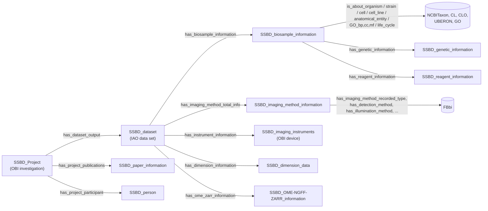

# SSBD Ontology: research and LAMBDA alignment

The SSBD Ontology is RIKEN's OWL model for the metadata of the [Systems Science of Biological Dynamics database](https://ssbd.riken.jp) (SSBD). SSBD shares light-microscopy and volume-EM images of cells, tissues and whole organisms, and quantitative data derived from them. The ontology matters to LAMBDA for two reasons. It is a working example of describing bioimages with OBO vocabularies (FBbi for imaging methods; NCBITaxon, CL, UBERON and GO for the specimen). Its two-tier split also resembles the one between LAMBDA's RO-Crate core profile and the full LinkML Dataset.

Research date: 2026-11-09. Scope: the ontology files and example instances in the `openssbd/ssbd-ontology` repository, and the live SSBD SPARQL endpoint, compared with this repository's schema. This is a design assessment, not an implemented crosswalk or ingest. No schema changes were made.

## Findings

- **Aligning matters more than importing.** SSBD and LAMBDA overlap only at the edges. SSBD has no macromolecule, structure, crystallography, scattering or single-particle content. LAMBDA has little for light microscopy. Where they meet (specimen biology, imaging method, image geometry, OME-Zarr storage), SSBD uses OBO terms that LAMBDA already uses (NCBITaxon, UBERON, CL, GO, CHEBI, UO) or could adopt cheaply (FBbi, CLO). If both sides use the same IRIs, LAMBDA records and the SSBD graph join without a crosswalk.
- **FBbi is the main gap.** LAMBDA describes techniques with CHMO and PaNET and has no FBbi terms. SSBD, the BioImage Archive and IDR use FBbi for imaging methods. FBbi also has distinct terms that LAMBDA lacks today. One is cryo-electron tomography (`FBbi:00100015`), which LAMBDA's `TechniqueEnum.cryo_et` currently shares with `cryo_em` (`CHMO:0002413`). Others cover FIB-SEM (`FBbi:00050000`) and cryo-FIB-SEM (`FBbi:00100017`). See [Recommendations](#recommendations).
- **SSBD is still settling, so don't import it.** It has domain-less properties, near-duplicate property pairs, test classes in the release, measurements stored as strings with units, and a predicate typo still present in the Git snapshot. The live endpoint has fixed the typo. Depending on the SSBD IRIs would tie LAMBDA to a model that is still changing; depending on the OBO terms underneath does not.

## Authoritative sources and versions

| Source | Purpose |
| --- | --- |
| [openssbd/ssbd-ontology @ `0957cae`](https://github.com/openssbd/ssbd-ontology/tree/0957cae1fd3b6d65f03f7137625d3eab33274bc7) | OWL/Turtle ontology (`ontology/ssbd_v20250512.ttl`, `ssbd_core.owl`, `ssbd_integrated.owl`), example instances (`instance/`), SPARQL examples (`sparql/`). Last commit 2025-08-07 |
| [Zenodo 10.5281/zenodo.15700645](https://doi.org/10.5281/zenodo.15700645) | Archived release v20250512, CC-BY 4.0 |
| [BioPortal: SSBD](https://bioportal.bioontology.org/ontologies/SSBD) | Registry entry. Namespace `http://ssbd.riken.jp/ontology/` |
| [Yamagata et al., arXiv:2508.02084](https://arxiv.org/abs/2508.02084) | *SSBD Ontology: A Two-Tier Approach for Interoperable Bioimaging Metadata*, ISWC 2025 (LNCS 16141) |
| [SPARQL endpoint](https://knowledge.brc.riken.jp/bioresource/sparql) | Live graph `http://metadb.riken.jp/ontology/SSBD` |
| [foundingGIDE D6.1, 10.5281/zenodo.15553217](https://doi.org/10.5281/zenodo.15553217) | Ontology usage across SSBD, IDR and BIA; REMBI → SSBD field mapping |

The figures below come from parsing the Turtle files with `rdflib` and from queries sent to the live endpoint on the research date. The paper was used for context only; it was not checked line by line against the files.

## Model

### Two tiers

SSBD splits its metadata into two tiers:

- **SSBD:repository** takes deposits quickly. It needs only enough metadata to mint a DOI: project, dataset, publication and people.
- **SSBD:database** is the curated, added-value tier. It adds the specimen biology, imaging method, instrument, image dimensions and OME-Zarr access to the same dataset records.

LAMBDA has a similar split. The RO-Crate core profile is the small set a facility can always produce. The full LinkML `Dataset` holds the curated relational detail.

### Core classes

The release declares about 1,480 named classes, but only 34 are in the SSBD namespace. The rest are copied from other ontologies:

| Source | Classes | Source | Classes |
| --- | --- | --- | --- |
| FBbi | 527 | CL | 69 |
| GO | 343 | IAO | 62 |
| NCBI Gene (non-OBO IRIs) | 131 | CLO | 56 |
| UBERON | 84 | UO | 39 |
| NCBITaxon | 75 | OBI, CHEBI, BFO | 21, 12, 9 |

The SSBD classes hang from BFO, OBI and IAO. Most of them are *information content entities*: a biosample record is information about an organism, not the organism itself.



There are 40 object properties and 113 datatype properties in the SSBD namespace.

### FBbi facets as separate properties

The most reusable design choice in SSBD is how it handles imaging method. It does not use a single "technique" slot. Its `has_imaging_method` property has sub-properties, and each takes its range from one branch of FBbi:

| Property | FBbi range |
| --- | --- |
| `has_imaging_method_recorded_type` | microscopy |
| `has_detection_method` | detection method (CMOS, PMT, CCD) |
| `has_illumination_method` | illumination method (e.g., light-sheet) |
| `has_contrast_enhancing_method` | contrast-enhancing method (e.g., Wollaston prism) |
| `has_visualization_method` | visualization method (e.g., RFP) |
| `has_sample_preparation_method` | sample preparation method |
| `has_source_of_contrast`, `has_imaged_parameter`, `has_resolution_enhancing_method` | the corresponding FBbi branches |

The specimen side works the same way, with one property per vocabulary: `is_about_organism` → NCBITaxon, `is_about_cell` → CL, `is_about_cell_line` → CLO, `is_about_anatomical_entity` → UBERON, `is_about_GO_cc`/`_bp`/`_mf` → GO.

## What the data look like

### Live endpoint

On the research date the live graph held **67 datasets in 7 projects** (SSBD projects 2, 48, 98, 141, 163, 170 and 199). These are curated examples, not the whole SSBD holding. Imaging methods by dataset:

| FBbi term | Datasets |
| --- | --- |
| `FBbi:00000251` confocal microscopy | 28 |
| `FBbi:00050000` FIB-SEM | 17 |
| `FBbi:00000246` fluorescence microscopy | 16 |
| `FBbi:00000364` light-sheet illumination | 3 |
| `FBbi:00000245` DIC microscopy | 3 |
| `FBbi:00000367` FRET | 2 |

The query that produced this table:

```sparql
PREFIX ssbd: <http://ssbd.riken.jp/ontology/>
PREFIX rdfs: <http://www.w3.org/2000/01/rdf-schema#>
SELECT ?m (SAMPLE(STR(?l)) AS ?label) (COUNT(DISTINCT ?d) AS ?n)
WHERE {
  ?d ssbd:has_imaging_method_total_info/ssbd:has_imaging_method_recorded_type ?m .
  OPTIONAL { ?m rdfs:label ?l }
}
GROUP BY ?m ORDER BY DESC(?n)
```

### Git snapshot

In `instance/SSBD_all_instances.ttl` the organisms are mouse (47), human (13), *C. elegans* (3), dog (2) and marmoset (1). Cell lines are HeLa and MDCK (CLO). GO cellular component is mostly mitochondrion and cristae. Strains are given as resolver URLs (JAX `000664` for C57BL/6J, RIKEN BRC, CGC `N2`), not CURIEs.

One dataset as it appears in the graph (project 199, an AMATERAS mouse brain slice):

```turtle
ssbd:ssbd-dataset-199-Fig2_BrainSliceRGB a ssbd:SSBD_dataset ;
    ssbd:has_dataset_title "AMATERAS imaging of mouse brain slice." ;
    ssbd:has_biosample_information ssbd:ssbd-biosample-199-Fig2_BrainSliceRGB ;    # NCBITaxon:10090, JAX 000664
    ssbd:has_imaging_method_total_info ssbd:ssbd-imaging-method-199-Fig2_BrainSliceRGB ; # FBbi:00000246, detector FBbi:00000304
    ssbd:has_dimension_information ssbd:ssbd-dimension-199-Fig2_BrainSliceRGB ;
    ssbd:has_ome_zarr_information ssbd:ssbd-ome-ngff-199-Fig2_BrainSliceRGB .

ssbd:ssbd-dimension-199-Fig2_BrainSliceRGB
    ssbd:has_dimensions "13264x9180x1x3x1" ;
    ssbd:has_x_scale "1.1 micrometer" ; ssbd:has_y_scale "1.1 micrometer" ;
    ssbd:has_channel_number "3 channels" .

ssbd:ssbd-ome-ngff-199-Fig2_BrainSliceRGB
    ssbd:has_axes "XYC" ; ssbd:has_size_x 13264 ; ssbd:has_size_y 9180 ; ssbd:has_size_c 3 ;
    ssbd:has_s3_endpoint "https://ssbd.riken.jp/100118-dcacbb41/zarr/v0.4/Fig2_BrainSliceRGB.zarr"^^xsd:anyURI ;
    ssbd:has_vizarr_url "https://ssbd.riken.jp/mmiranda/vizarr/?source=…"^^xsd:anyURI .
```

### Quality notes for anyone ingesting SSBD

- **Measurements are strings with units in them.** Scales look like `"1.1 micrometer"`, and dimensions like `"13264x9180x1x3x1"` with the axis order implied. The ontology defines `SSBD_X/Y/Z_dimension_data` and imports UO, but the instances don't use them. Only the OME-NGFF node carries integer sizes. An ingest has to parse value and unit, as LAMBDA's `QuantityValue` requires.
- **Instrument parts are free text.** `has_body "ZEISS CrossBeam 540"`, `has_objective "Leica HCX PL APO CS 10x/0.40 DRY"` and `has_detector "Andor Neo 5.5 CL"` are datatype properties. The `device_objective`, `detector` and `light_source` classes exist but aren't instantiated, and there are no instrument identifiers.
- **The predicate typo survives in the Git snapshot.** In `SSBD_all_instances.ttl`, 15 imaging-method nodes (projects 2, 48, 141, 199) still use the misspelled `has_imaging_mehod_recorded_type`. Run against that file, the README's method query finds only 40 of 66 datasets. The live endpoint returns the corrected predicate (69 links, none misspelled), so load from the endpoint, or rewrite the predicate first.
- **Ranges are loose.** `has_imaging_method_recorded_type` declares FBbi *microscopy* as its range, yet the live graph puts light-sheet *illumination* (`FBbi:00000364`) and FRET in it. Most SSBD properties have no domain or range at all.
- **The schema has some churn.** There are near-duplicate properties (`has_pmc_id`/`has_pmcid`, `has_note`/`has_notes`, `has_dimension`/`has_dimensions`, `has_phone`/`has_phone_number`, `_2` variants), two test classes in the release (`ssbd-biosample-test_class141-Fig1a`, `…_human-Fig1a`), and a second namespace (`https://ssbd.riken.jp/ontology/has_e-mail`).

## Crosswalk to LAMBDA

| SSBD | LAMBDA today | Fit |
| --- | --- | --- |
| `SSBD_Project` | `Study` | Good for grouping |
| `has_project_participant` (`SSBD_person`, ORCID), `laboratory` | `Person` (`orcid`) via `StudyPersonAssociation`; `Organization` via `StudyOrganizationAssociation` | Good |
| `has_project_publications` (PMID, DOI), `has_license` | No `Study` slot in the LinkML schema. The RO-Crate profile has `citation` and `license` | Crate-level only |
| `SSBD_dataset` (one figure's image set) | `ExperimentRun` plus `Image*`/`DataFile` outputs | Partial. SSBD merges the acquisition and its output |
| `is_about_organism` (NCBITaxon) | `Sample.organism` (`OntologyTerm`) | Same vocabulary |
| `is_about_anatomical_entity` (UBERON) | `Sample.anatomy` | Same vocabulary |
| `is_about_cell` (CL) | `Sample.cell_type` | Same vocabulary |
| `is_about_cell_line` (CLO) | none on `Sample`. `ProteinConstruct.host_strain_or_cell_line` is the expression host, as free text | **Gap** |
| `is_about_strain` (JAX/BRC/CGC URLs) | none | **Gap** |
| `is_about_GO_cc/bp/mf` | none on `Sample`. `SampleComponent.ontology_term` can name a GO CC organelle *constituent* | Partial, different meaning |
| `has_reagent_information` (stains, antibodies, with concentration) | `SampleComponent` + `SmallMolecule` (CHEBI), `BufferComposition` | Partial. LAMBDA's form is more structured |
| `SSBD_genetic_information` (gene, genotype, Ensembl, UniProt) | `Protein`, `ProteinConstruct` | Different purpose: SSBD records reporters and knockouts in the specimen |
| `has_imaging_method_recorded_type` and FBbi facets | `ExperimentRun.technique` (`TechniqueEnum`, CHMO). `OpticalImage.illumination_type` (`IlluminationTypeEnum`, no `meaning`s) | **Vocabulary gap** (FBbi) |
| `SSBD_imaging_instruments` (body, objective, detector, light source) | `Instrument` with `instrument_category: OPTICAL_MICROSCOPE`. No optical subclass. Filters are strings on `FluorescenceImage` | Gap, low priority |
| `SSBD_dimension_data` | `Image.pixel_size`, `voxel_size`, `dimensions_x/y/z` (`QuantityValue`) | LAMBDA is better typed. No time-lapse frame interval |
| `SSBD_OME-NGFF-ZARR_information` | `DataFile`. `FileFormatEnum` has no `zarr`/`ome_zarr` | **Gap**, also raised in [CZ cryoET](czi-cryoet.md) |

## Recommendations

The first two changes are small, and they would make LAMBDA records join with SSBD, BIA and IDR on shared IRIs. None of them needs the SSBD ontology itself.

1. **Add the `FBbi` prefix and FBbi mappings.**
   - Give `IlluminationTypeEnum` `meaning`s. The FBbi IDs below were checked against OLS:

     | Value | FBbi term |
     | --- | --- |
     | `brightfield` | `FBbi:00000243` |
     | `darkfield` | `FBbi:00000244` |
     | `phase_contrast` | `FBbi:00000247` |
     | `dic` | `FBbi:00000245` |
     | `fluorescence` | `FBbi:00000246` |
     | `confocal` | `FBbi:00000251` |
     | `polarized` | `FBbi:00000248` |
     | `oblique` | `FBbi:00000285` |

   - Add FBbi `exact_mappings` to `TechniqueEnum`: `electron_microscopy` → `FBbi:00000256`, `cryo_et` → `FBbi:00100015`, `xray_tomography` → `FBbi:00001003`. The `cryo_et` mapping gives cryo-ET an identifier of its own, which CHMO doesn't (see the comment on that value).
   - FBbi treats `fluorescence` and `confocal` as kinds of microscopy, not illumination. SSBD keeps them apart with its faceted properties. If LAMBDA adds light-microscopy depth, it should split `IlluminationTypeEnum` the same way, not keep extending it.
2. **Add OME-Zarr to `FileFormatEnum`.** SSBD, the CZ cryoET portal and IDR all publish OME-Zarr, and LAMBDA can't yet say a `DataFile` is one.
3. **Consider `strain` and `cell_line` on `Sample`** as `OntologyTerm` slots. Cell lines could use CLO or Cellosaurus; strains could use the repository's CURIE (e.g., JAX), not a URL. This matters once LAMBDA describes in-situ and correlative work (cryo-ET of lamellae, CLEM), where SSBD-style specimen context is the norm. It is not needed for purified-protein samples.
4. **Don't import or depend on SSBD IRIs.** The ontology uses non-OBO IRIs, carries most of its content as copied OBO classes, and is still changing. Reference SSBD datasets by their project URL or DOI where LAMBDA links to them.
5. **An SSBD reader is possible, but it isn't a priority.** The endpoint is open and small, and one query returns dataset, specimen, FBbi method and OME-Zarr URL. A reader would need to parse string measurements and normalize strain URLs. The closest overlap with LAMBDA's facilities is the FIB-SEM mouse-brain volumes (project 141), and they would be useful only as correlative context.

## Verification

- Parsed `ontology/ssbd_v20250512.ttl` and `instance/SSBD_all_instances.ttl` at `0957cae` with `rdflib`, and counted classes, properties and instance types.
- Queried the live endpoint for dataset and project counts, imaging-method distribution, and both spellings of the method predicate.
- Checked FBbi IDs in the recommendations against OLS.
- Did not download images or Zarr stores, did not load `ssbd_integrated.owl` into a reasoner, and did not check the foundingGIDE D6.1 tables.
